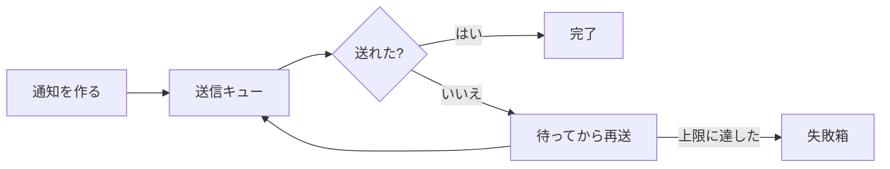

# 通知の再送設計（サンプル）

これは動作確認用の作り話です。実在の会社・製品・データとは関係ありません。

## 一言でいうと

送れなかった通知を、間隔を空けながら決まった回数だけ送り直す仕組みです。送り直しても届かない通知は「失敗箱」に移し、人が確かめます。

## 全体像

通知はまず送信キューに入ります。送信役がキューから取り出して送り、失敗したら少し待ってからキューに戻します。

## 要素ごとの説明

### 送信キュー

送る前の通知を順番に並べておく場所です。通知1件ごとに「何回目の送信か」を覚えています。

### 再送の間隔

失敗した通知は指数バックオフで最大5回再送する。指数バックオフとは、待つ時間を1分、2分、4分のように倍々に延ばすやり方です。5回すべて待つと合計31分になります。

~~~~ts src/notify/retry.ts:12
export function nextDelayMs(attempt: number): number {
  const base = 60_000; // 1分
  return base * 2 ** (attempt - 1);
}

export const MAX_ATTEMPTS = 5;
~~~~

### 失敗箱

上限まで再送しても届かなかった通知を置く場所です。失敗箱の通知は運用担当が毎朝確かめる。確かめた後に手で送り直すか、捨てるかを選べます。

## 決める事項

### d1 再送上限は5回でよいか

> 失敗した通知は指数バックオフで最大5回再送する。

上限が少ないと、一時的な障害で通知を落とします。多いと、届かない通知のために長く待つことになります。

- 5回
- 10回
- 時間で打ち切る（30分）

### d2 失敗箱を誰がいつ確かめるか

> 失敗箱の通知は運用担当が毎朝確かめる。

文書には「運用担当が毎朝」とだけあり、休日や担当の決め方は書かれていません。

## 読むときの注意

- 「送信役」が何台で動くかは、元の文書に書かれていません。
- 通知の宛先が無効なとき（退会した利用者など）も再送するのかは、元の文書では曖昧です。
